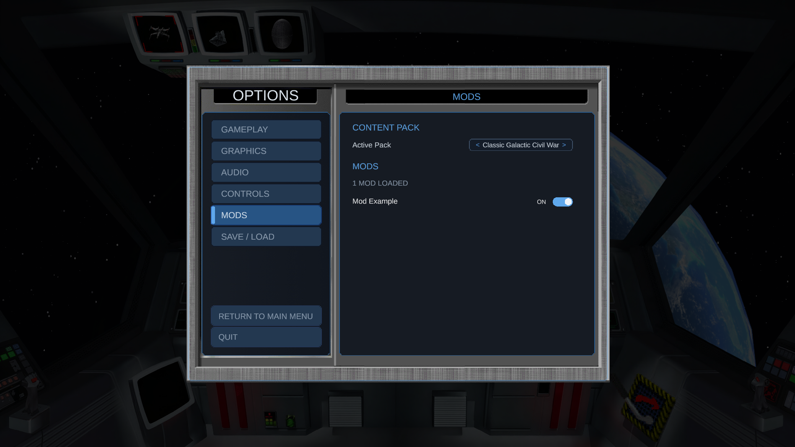

# Modding

Rebellion 2 loads modded art, audio, video, configuration, and game data from loose files. Most
content can therefore be changed without rebuilding the game.

## Creating a mod

A Rebellion 2 mod is a folder containing a `mod.xml` definition and a `Content` folder. It can
replace art, audio, video, configuration, or game-data files without rebuilding the game.

### 1. Find the Mods directory

Run Rebellion 2 once so the installer or launcher can finish creating the game directories. Open
the directory containing the installed `Content` folder, then open `Mods` beside it.

On Windows, the default installation has this layout:

```text
%LOCALAPPDATA%\Programs\AdasGames\Rebellion 2\
  Content\
  Mods\
  Rebellion2.exe
  rebellion2-launcher.exe
```

On macOS, press **Command+Shift+G** in Finder and open
`~/Library/Application Support/Rebellion 2`. The launcher stores player-managed content there,
regardless of where `Rebellion2.app` is installed:

```text
~/Library/Application Support/Rebellion 2/
  Content/
  Mods/
```

When developing from the Unity project, use `Assets/Mods`.

### 2. Create the mod definition

Create a new folder directly inside `Mods`. For this example, create `ModExample`, then add a
`mod.xml` file containing:

```xml
<ContentModDefinition>
  <ID>mod-example</ID>
  <Version>1.0.0</Version>
  <DisplayName>Mod Example</DisplayName>
  <BasePackID>classic-galactic-civil-war</BasePackID>
  <BasePackVersion>1.0.0</BasePackVersion>
</ContentModDefinition>
```

`ID` is the stable identifier stored in saves, `Version` identifies the installed revision, and
`DisplayName` is shown in the game. `BasePackID` and `BasePackVersion` identify the exact content
pack release the mod supports.

### 3. Add replacement content

Create a `Content` folder beside `mod.xml`. Inside it, reproduce the path of every original file
the mod replaces. For example:

```text
Mods/
  ModExample/
    mod.xml
    Content/
      Pack/
        Factions/
          Alliance/
            Data/
              capital-ships.xml
      Application/
        MainMenu/
          UI/
            optional-replacement.png
```

A mod replaces a complete file at the matching logical path. It does not normally merge individual
objects or XML fields within that file. Files beneath the mod's `Content/Pack` directory replace
files from the selected base pack; files beneath `Content/Application` replace shared application
files. Copy the original file into the matching mod path, edit the copy, and leave the installed
`Content` file unchanged. The pack `game.xml` is the exception: it remains a sparse override merged
over the application `game.xml`. Files can explicitly opt into setting inheritance with
`Inherit="true"`, as described below.

The game editor exposes **Game rules > AI decisions** for changing the number of ticks between
new AI assignments at each difficulty. The default intervals are 7 ticks on Easy, 5 on Normal
(`Medium` in XML), and 1 on Hard. Existing fleet orders continue every tick, including combat and
arrival checks; movement, construction, and ongoing missions also continue normally.

For example, a pack's `game.xml` can configure the intervals. Include every difficulty when
overriding this table, because lookup tables replace the inherited table:

```xml
<GameConfig>
  <AI>
    <DecisionTickIntervals>
      <Entry>
        <Key>Easy</Key>
        <Value>7</Value>
      </Entry>
      <Entry>
        <Key>Medium</Key>
        <Value>5</Value>
      </Entry>
      <Entry>
        <Key>Hard</Key>
        <Value>1</Value>
      </Entry>
    </DecisionTickIntervals>
  </AI>
</GameConfig>
```

Custom games expose **World generation > AI behavior > AI decision interval (ticks)**. An edited
value overrides the selected difficulty for that campaign and is retained in custom presets and
saves. Use a positive whole number; 1 evaluates new assignments every tick.

### 4. Enable the mod

Launch Rebellion 2 and open **Options > Mods**. A compatible definition appears by its
`DisplayName`:



Use the switch to enable or disable the mod, then select **Apply**. The game reloads the selected
content and returns to the main menu without closing. If the mod does not appear, confirm that
`mod.xml` is directly inside the mod folder and that its `BasePackID` and `BasePackVersion` match the
active content pack. Invalid definitions are skipped without preventing other mods from loading; the
game log identifies the invalid file and reason.

Mods load by folder name in ordinal order. If two enabled mods replace the same file, the later
folder wins. Custom load-order controls are not yet supported. Files not supplied by a mod fall back
to the selected content pack and then the shared application content.

## Derived content packs

A selectable content pack can inherit files from another installed pack by declaring its ID in
`pack.xml`:

```xml
<ContentPack>
  <ID>example-derived-pack</ID>
  <BasePackID>example-base-pack</BasePackID>
  <!-- The remaining pack definition is omitted here. -->
</ContentPack>
```

Files present in the derived pack override files at the same `Pack/` address. Missing files fall
back through the declared base-pack chain. Each derived pack still provides a complete `pack.xml`
so its scenarios, factions, preload manifests, and identity remain explicit. Circular inheritance,
missing base packs, and duplicate IDs in the active inheritance chain are rejected during loading.

### Setting inheritance

Structured content XML can opt into setting inheritance by adding `Inherit="true"` to its root.
The game loads the inherited document first and applies only the values present in the overlay.
For example, a derived pack can change one Empire theme setting in
`Factions/Empire/Strategy/UI/theme.xml`:

```xml
<FactionThemes Inherit="true">
  <FactionTheme>
    <FactionInstanceID>FNEMP1</FactionInstanceID>
    <UseUpperButtonLayout>false</UseUpperButtonLayout>
  </FactionTheme>
</FactionThemes>
```

Every other Empire theme setting, including image paths, remains inherited. The file also retains
other factions supplied by the inherited document. Explicit `0`, `false`, and empty string values
are overrides; omitting a setting inherits it.

Unit and sector records are matched by `TypeID`. Planets, factions, and events use `InstanceID`;
themes use `FactionInstanceID`, officer traits use their `ID` attribute, and dictionary entries use
`Key`. Omitted identified records remain inherited. Remove an identified record explicitly with
`Remove="true"` on that record and its identifying member. An overlay can remove an optional
member with `Remove="true"` on that member, or remove an attribute with
`RemoveAttributes="AttributeName"` on its containing element. Resetting an override instead removes
the local instruction and restores the inherited value.

Ordered or unidentified collections, such as action lists, conditions, and rank lists, replace the
inherited collection as a whole when supplied. An empty ordered collection clears the list. Do not
expect individual actions to be matched by their position or by the variables they reference.
Documents whose root is itself an ordered or unidentified collection use a complete replacement
when edited, including when the last entry is removed.

The content editor displays resolved inherited values while keeping their authored overrides
separate. Editing an inherited document saves only the changed settings. Fields show **Inherited**
when they have no local override. **Reset to inherited** removes the selected override; resetting
the last override removes the unnecessary local file. Undo, redo, exports, and test snapshots retain
the authored overrides rather than copying displayed defaults into the pack.

Existing files without `Inherit="true"` keep their full-replacement behavior. Resetting a setting
in an existing replacement retains its other authored values. `pack.xml` and `mod.xml` remain
complete identity and dependency manifests. Packs using setting overlays require game and editor
builds that support this format; distribution metadata must require a compatible game version.

## Sharing a mod

Package the mod folder containing `mod.xml` and `Content`; players install it by extracting that
folder directly into `Mods`. The installer, launcher, and application and content updaters do not
overwrite `Mods`.

Only distribute files you have the right to distribute. For mods based on the classic pack,
distribute only your mod definition and replacement files. Players and mod developers must own
*Star Wars: Rebellion* or *Star Wars: Empire at War: Gold Pack* and obtain the original content
through the ownership-verifying installer.

## Guides

- [Creating game events](Scripting/Events/Index.md)
- [Creating and modifying units](Units/Index.md)

## Compatibility

Saves require the active pack ID, version, scenario, and ordered mod IDs and versions to match.
Increment a mod's version when publishing compatibility-breaking changes, then test both new games
and existing saves. Use the Options menu's Mods page to select a content pack and enable or disable
its compatible mods. Select **Apply** to reload those changes and return to the main menu.
