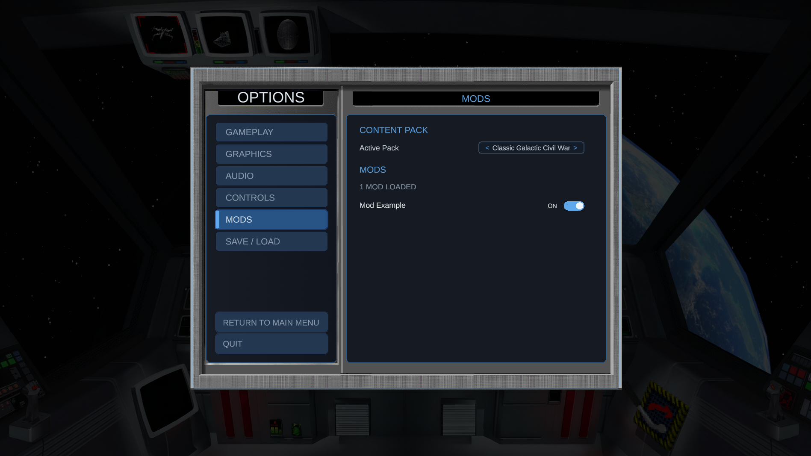

# Modding

Rebellion 2 loads modded art, audio, video, configuration, and game data from loose files. Most
content can therefore be changed without rebuilding the game.

## Creating a mod

A Rebellion 2 mod is a folder containing a `mod.xml` definition and a `Content` folder. It can
replace art, audio, video, configuration, or game-data files without rebuilding the game.

### 1. Find the Mods directory

Run Rebellion 2 once so the installer or launcher can finish creating the game directories. Open
the directory containing the installed `Content` folder, then open `Mods` beside it.

On Windows, the default installation has this layout:

```text
%LOCALAPPDATA%\Programs\AdasGames\Rebellion 2\
  Content\
  Mods\
  Rebellion2.exe
  rebellion2-launcher.exe
```

On macOS, press **Command+Shift+G** in Finder and open
`~/Library/Application Support/Rebellion 2`. The launcher stores player-managed content there,
regardless of where `Rebellion2.app` is installed:

```text
~/Library/Application Support/Rebellion 2/
  Content/
  Mods/
```

When developing from the Unity project, use `Assets/Mods`.

### 2. Create the mod definition

Create a new folder directly inside `Mods`. For this example, create `ModExample`, then add a
`mod.xml` file containing:

```xml
<ContentModDefinition>
  <ID>mod-example</ID>
  <Version>1.0.0</Version>
  <DisplayName>Mod Example</DisplayName>
  <BasePackID>classic-galactic-civil-war</BasePackID>
  <BasePackVersion>1.0.0</BasePackVersion>
</ContentModDefinition>
```

`ID` is the stable identifier stored in saves, `Version` identifies the installed revision, and
`DisplayName` is shown in the game. `BasePackID` and `BasePackVersion` identify the exact content
pack release the mod supports.

### 3. Add replacement content

Create a `Content` folder beside `mod.xml`. Inside it, reproduce the path of every original file
the mod replaces. For example:

```text
Mods/
  ModExample/
    mod.xml
    Content/
      Pack/
        Factions/
          Alliance/
            Data/
              capital-ships.xml
      Application/
        MainMenu/
          UI/
            optional-replacement.png
```

A mod replaces a complete file at the matching logical path. It does not normally merge individual
objects or XML fields within that file. Files beneath the mod's `Content/Pack` directory replace
files from the selected base pack; files beneath `Content/Application` replace shared application
files. Copy the original file into the matching mod path, edit the copy, and leave the installed
`Content` file unchanged. The pack `game.xml` is the exception: it remains a sparse override merged
over the application `game.xml`. Files can explicitly opt into setting inheritance with
`Inherit="true"`, as described below.

The game editor exposes **Game rules > AI decisions** for changing the number of ticks between
new AI assignments at each difficulty. The default intervals are 7 ticks on Easy, 5 on Normal
(`Medium` in XML), and 1 on Hard. Existing fleet orders continue every tick, including combat and
arrival checks; movement, construction, and ongoing missions also continue normally.

For example, a pack's `game.xml` can configure the intervals. Include every difficulty when
overriding this table, because lookup tables replace the inherited table:

```xml
<GameConfig>
  <AI>
    <DecisionTickIntervals>
      <Entry>
        <Key>Easy</Key>
        <Value>7</Value>
      </Entry>
      <Entry>
        <Key>Medium</Key>
        <Value>5</Value>
      </Entry>
      <Entry>
        <Key>Hard</Key>
        <Value>1</Value>
      </Entry>
    </DecisionTickIntervals>
  </AI>
</GameConfig>
```

Custom games expose **World generation > AI behavior > AI decision interval (ticks)**. An edited
value overrides the selected difficulty for that campaign and is retained in custom presets and
saves. Use a positive whole number; 1 evaluates new assignments every tick.

### 4. Enable the mod

Launch Rebellion 2 and open **Options > Mods**. A compatible definition appears by its
`DisplayName`:



Use the switch to enable or disable the mod, then select **Apply**. The game reloads the selected
content and returns to the main menu without closing. If the mod does not appear, confirm that
`mod.xml` is directly inside the mod folder and that its `BasePackID` and `BasePackVersion` match the
active content pack. Invalid definitions are skipped without preventing other mods from loading; the
game log identifies the invalid file and reason.

Mods load by folder name in ordinal order. If two enabled mods replace the same file, the later
folder wins. Custom load-order controls are not yet supported. Files not supplied by a mod fall back
to the selected content pack and then the shared application content.

## Derived content packs

A selectable content pack can inherit files from another installed pack by declaring its ID in
`pack.xml`:

```xml
<ContentPack>
  <ID>example-derived-pack</ID>
  <BasePackID>example-base-pack</BasePackID>
  <!-- The remaining pack definition is omitted here. -->
</ContentPack>
```

Files present in the derived pack override files at the same `Pack/` address. Missing files fall
back through the declared base-pack chain. Each derived pack still provides a complete `pack.xml`
so its scenarios, factions, preload manifests, and identity remain explicit. Circular inheritance,
missing base packs, and duplicate IDs in the active inheritance chain are rejected during loading.

### Setting inheritance

Structured content XML can opt into setting inheritance by adding `Inherit="true"` to its root.
The game loads the inherited document first and applies only the values present in the overlay.
For example, a derived pack can change one Empire theme setting in
`Factions/Empire/Strategy/UI/theme.xml`:

```xml
<FactionThemes Inherit="true">
  <FactionTheme>
    <FactionInstanceID>FNEMP1</FactionInstanceID>
    <UseUpperButtonLayout>false</UseUpperButtonLayout>
  </FactionTheme>
</FactionThemes>
```

Every other Empire theme setting, including image paths, remains inherited. The file also retains
other factions supplied by the inherited document. Explicit `0`, `false`, and empty string values
are overrides; omitting a setting inherits it.

Unit and sector records are matched by `TypeID`. Planets, factions, and events use `InstanceID`;
themes use `FactionInstanceID`, officer traits use their `ID` attribute, and dictionary entries use
`Key`. Omitted identified records remain inherited. Remove an identified record explicitly with
`Remove="true"` on that record and its identifying member. An overlay can remove an optional
member with `Remove="true"` on that member, or remove an attribute with
`RemoveAttributes="AttributeName"` on its containing element. Resetting an override instead removes
the local instruction and restores the inherited value.

Ordered or unidentified collections, such as action lists, conditions, and rank lists, replace the
inherited collection as a whole when supplied. An empty ordered collection clears the list. Do not
expect individual actions to be matched by their position or by the variables they reference.
Documents whose root is itself an ordered or unidentified collection use a complete replacement
when edited, including when the last entry is removed.

The content editor displays resolved inherited values while keeping their authored overrides
separate. Editing an inherited document saves only the changed settings. Authored overrides use a
distinct input color. The reset button names what it resets, for example **Reset artwork**.
It clears the overrides shown in the active tab and uses the inherited or built-in defaults.
Resetting the last override removes the unnecessary local file. Undo, redo, exports, and test
snapshots retain the authored overrides rather than copying displayed defaults into the pack.

Artwork edits count as unsaved changes. Saving the pack commits its current files; discarding
changes restores the files and settings from the last successful save. Undoing an image change
after saving marks the pack as unsaved again. If another application changes a file, discard
stops without overwriting it, and closing retains the recovery files if restoration fails.
If a save fails partway through writing settings, the editor attempts to restore every written
document. Blocked restores keep the pack marked as unsaved and retain the preceding files with
a recovery manifest. After resolving the reported file conflict or permissions, retry Save or
Discard to finish recovery.

Artwork undo and redo belong to the open editing session. Temporary revisions are stored in a
separate `.rebellion2-editor/History/<session>` directory for each open project and are removed
when that project closes, is replaced, or the editor exits normally. Ordinary saves and refreshing
the same project preserve its undo history. Cleanup preserves authored artwork, editable layer
sources, conversion backups, and revisions owned by other open projects. Files left by older
editor versions or interrupted sessions are not automatically deleted.

Existing files without `Inherit="true"` keep their full-replacement behavior. Resetting a setting
in an existing replacement retains its other authored values. `pack.xml` and `mod.xml` remain
complete identity and dependency manifests. Packs using setting overlays require game and editor
builds that support this format; distribution metadata must require a compatible game version.

Message definitions with stable `InstanceID` values inherit per report and per setting. Changing
one report's picture keeps the other reports and its unedited text inherited. Keep an existing
report's ID when changing its text or outcome; give a new report its own unique ID. Removing a
report records an explicit removal so future base updates do not bring it back.

Older anonymous message lists remain complete replacements, including their omissions. They are
not automatically converted or rewritten. Explicitly reordering existing reports also retains a
complete replacement because their lookup order affects which report is selected.

### Main menu

Open **Interfaces > Main Menu** to preview the default scenario's cockpit and launch controls.
The preview starts paused. Select **Play** to see it animate. Drag a highlighted control to move
it, or double-click its artwork to open the image or model field. The fields below the preview
also let you edit background artwork. Replacement images for Load Game,
Multiplayer, and Exit display as still artwork. Medallions use the selected faction's GLB.
Galaxy size controls have separate fields for the monitor artwork and the selection icon.
Drag a selection frame by its visible outline to position it independently of its icon.
The **Advanced** tab lets you edit the layout XML. Zero offsets restore the generated positions.

### Shared interfaces

Open **Interfaces** to edit the **Planet Sector Window**, **Planet Window Header**, and
**Confirmation Window**. Select an element in the preview to move it by dragging or nudge it with
the arrow keys or WASD. Click an empty area to clear the selection. The planet window preview
shows the header and its controls, including the **Header Text** position.

### Cutscenes

Open **Cutscenes** to edit the startup videos or a faction's videos. Each entry shows a still
from the assigned video. Use **Replace** to choose a new video and the preview dropdown to play
it fullscreen at a supported resolution. Click during playback to return to the editor.

### Faction and neutral themes

In the Content Pack Editor, open a faction's **Colors** tab to set its primary
color, selected menu text color, and individual interface tints. **Reset colors**
restores the inherited or default colors for that theme.

Check **Use primary color** to link a color to the primary palette. Matching
colors start linked and existing custom colors start independent. In
**Interfaces > Strategy view**, scroll over the preview, pinch on a Mac trackpad,
or use the zoom buttons. Drag wherever the hand cursor appears to pan. Drag
movable artwork directly, or hold Alt (Option on Mac) and drag to move a custom
galaxy background. **Fit to view** restores the full scene.

Open **Factions > Neutral** to preview and edit the neutral theme.
Double-click an outlined sector icon to open its image settings. Use
**Galaxy map icons** for neutral star markers and **Facility research icons** for
facility research artwork. Player HUD artwork is under each faction's
**Interfaces > Strategy view**.

### Unit artwork

In **Artwork**, the **Messages and encyclopedia** section holds the two 1800 × 900 images.
Choose **Use message image** or **Use encyclopedia image** to share one file between them.
**Generate cuts** uses the source image's actual dimensions to prevent upscaling.
Uncheck any cut you want to keep before choosing **Save cuts**.
For capital ships and starfighters, full-size display art can also be framed at native scale
on an encyclopedia canvas with the configured unit or faction background.
Message and encyclopedia images can also supply gameplay cuts.

### Planet artwork

The content editor's planet **General** page offers a thumbnail picker for the sector-map image.
The planet's **Encyclopedia** page has a separate picker for article artwork. Each picker lists
images already used for that purpose, including inherited images. **Add image…** copies an external
file into `Pack/Shared/Planets/`; other planets can then select it from the same picker.
**Replace shared image…** asks for confirmation before updating every planet using that file.
For inherited artwork, the replacement is written into the mod, leaving the base pack untouched.

### Artwork layers

In the travel or damage artwork editor, choose an output size and click **Add image…**.
PNG and JPEG files become independent layers you can move, scale, hide, and reorder.
When you save the artwork, the editor copies the source image into the pack and saves the layer
with that output so you can edit it again later.

Image pickers reopen in the last folder you imported from. On Windows and macOS, you can
also drag a PNG or JPEG onto an image slot or onto the artwork canvas to add a layer.

## Sharing a mod

### Community mods

Use **Browse** to install Thunderstore packages and their dependencies. Use **Library** to
choose the default pack or enable add-ons for the next game startup. **Install from file…**
accepts ZIP files. Close the game before updating or uninstalling its content; local edits are protected.

### Publishing a content pack

Open a working folder from **Projects**, then choose **Publish…**. Provide a package name,
description, readme, and 256 × 256 icon. Choose required packages, including any downloaded
base pack, under **Dependencies**.
**Save draft** retains unfinished work; **Export ZIP…** creates a package for manual upload.

For direct publishing, click the Thunderstore connection link. Create a service account in
[your team's settings](https://thunderstore.io/settings/teams/) and paste its token. The token is
stored in the operating system's credential store, never in the project or export. Linux requires
libsecret and a running Secret Service. Click the connection link after restarting to reconnect.

Select **Review release**, then **Publish release**. Every update needs a new content-pack version.
If submission times out, check the package's Thunderstore page before retrying.

### Sharing an add-on mod

Package the mod folder containing `mod.xml` and `Content`; players install it by extracting that
folder directly into `Mods`. The installer, launcher, and application and content updaters do not
overwrite `Mods`.

Only distribute files you have the right to distribute. For mods based on the classic pack,
distribute only your mod definition and replacement files. Players and mod developers must own
*Star Wars: Rebellion* or *Star Wars: Empire at War: Gold Pack* and obtain the original content
through the ownership-verifying installer.

## Guides

- [Creating game events](Scripting/Events/Index.md)
- [Creating and modifying units](Units/Index.md)

## Compatibility

Saves require the active pack ID, version, scenario, and ordered mod IDs and versions to match.
Increment a mod's version when publishing compatibility-breaking changes, then test both new games
and existing saves. Use the Options menu's Mods page to select a content pack and enable or disable
its compatible mods. Select **Apply** to reload those changes and return to the main menu.
